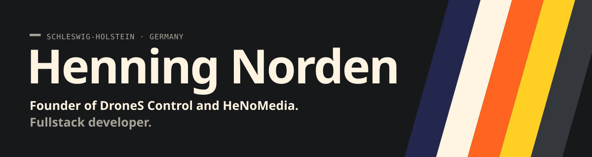
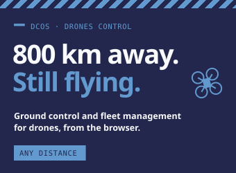
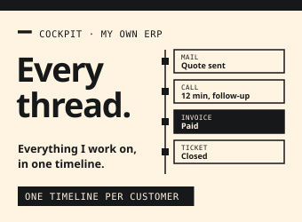
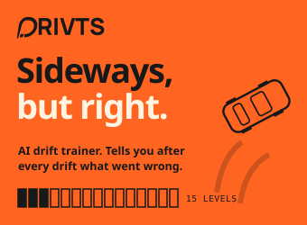
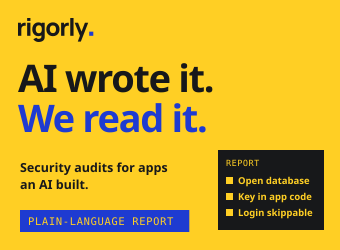
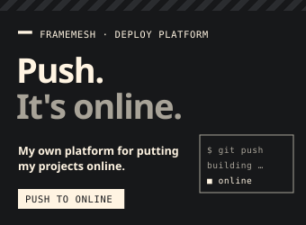

<a href="https://drones-control.com"><b>DroneS Control</b></a> &nbsp;·&nbsp;
<a href="https://github.com/HeNoMedia"><b>HeNoMedia</b></a> &nbsp;·&nbsp;
<a href="https://drivts.com"><b>Drivts</b></a> &nbsp;·&nbsp;
<a href="mailto:henning.norden@drones-control.com"><b>Email</b></a>

<a href="#deutsch">Deutsche Version ↓</a>

### 01 &nbsp;Profile

I run two companies and write a good part of the code myself. I want to understand the software I sell.

I started HeNoMedia at 17, building websites and shops. The projects got bigger over the years, and today most of my work is drone software for fire brigades and civil protection. When I need a tool that doesn't exist yet, I build it.

<table>
<tr><td width="170"><b>Focus</b></td><td>Ground control and fleet management for drones · hosting in Germany · self-hosted where possible</td></tr>
<tr><td><b>Based in</b></td><td>Schleswig-Holstein, Germany</td></tr>
</table>

> [!NOTE]
> Most of my code lives on our own Gitea in Germany, so the contribution graph here looks quieter than it is.

### 02 &nbsp;Selected work

<table>
<tr>
<td width="50%" valign="top">

#### DCOS &nbsp;<i>DroneS Control OS</i>
Ground control station and fleet management for drones

<a href="https://drones-control.com"><b>Website →</b></a>

More

With DCOS, a team plans, flies and manages its drones from the browser. Distance doesn't matter: a drone 800 km away can be flown just like one down the street. Mission planning, live video and the data of the whole fleet are in one system that runs on servers in Germany.

Fire brigades, civil protection units, municipalities and critical infrastructure operators use DCOS for their missions.

<b>Hardware</b> DJI Dock 3 and more &nbsp;·&nbsp; <b>Hosting</b> Germany · GDPR

</td>
<td width="50%" valign="top">

#### Cockpit &nbsp;<i>internal</i>
My own ERP

In daily use since March 2026

More

I built Cockpit to keep track of everything I'm working on: customers, quotes and invoices, projects, support requests, staff, inventory and newsletters in one place. Mails, calls and invoices show up on their own in one timeline per customer.

<b>For</b> Myself

</td>
</tr>
<tr>
<td width="50%" valign="top">

#### Drivts &nbsp;<i>early access</i>
AI drift trainer for Assetto Corsa

<a href="https://drivts.com"><b>drivts.com →</b></a>

More

Drivts runs next to Assetto Corsa, reads steering, throttle and drift angle, and tells you after each drift what went wrong. There are 15 levels with small tasks, and the next one unlocks once the current one works. I built it because I'm learning to drift myself.

<b>By</b> HeNoMedia &nbsp;·&nbsp; <b>Runs on</b> Linux · Windows planned &nbsp;·&nbsp; <b>Status</b> Early access, invite only

</td>
<td width="50%" valign="top">

#### Rigorly &nbsp;<i>in progress</i>
Security audits for apps an AI wrote

<a href="https://github.com/rigorly"><b>GitHub org →</b></a>

More

Rigorly takes a repository, looks for open databases, leaked keys and broken logins, and writes a report that people without a developer background can work with. A watch subscription keeps an eye on it afterwards.

<b>Stacks</b> Supabase · Next.js · Firebase · Node · React Native · Flutter &nbsp;·&nbsp; <b>Repos</b> GitHub · GitLab · Bitbucket · Gitea &nbsp;·&nbsp; <b>Your code</b> Deleted after the audit

</td>
</tr>
<tr>
<td width="50%" valign="top">

#### framemesh &nbsp;<i>internal</i>
My own deploy platform

Hosts my own projects

More

I push my code, and shortly after it's online, database included. It hosts my own projects, Cockpit included. I didn't want to depend on a hosting vendor, and it isn't for sale.

</td>
<td width="50%" valign="top"></td>
</tr>
</table>

### 03 &nbsp;Toolbox

<table>
<tr><th width="150" align="left">Area</th><th align="left">Tools</th><th align="left">Used for</th></tr>
<tr><td><b>Fullstack</b></td><td>TypeScript · Node.js · Next.js · React</td><td>Web apps · APIs · customer portals · my own ERP</td></tr>
<tr><td><b>Data</b></td><td>PostgreSQL · Drizzle · MongoDB · MinIO / S3 · EMQX</td><td>Telemetry over MQTT · media and map data</td></tr>
<tr><td><b>Drones</b></td><td>DJI Cloud API · DJI Dock 3 · MAVLink · PX4 / ArduPilot</td><td>OpenDroneID · drone detection · SORA</td></tr>
<tr><td><b>Infrastructure</b></td><td>Proxmox · TrueNAS · Gitea + act_runner · Caddy · NetBird · Teleport</td><td>Our own servers</td></tr>
</table>

<b>&nbsp;Deutsche Version</b>

 

### 01 &nbsp;Profil

Ich führe zwei Firmen und schreibe einen guten Teil des Codes selbst. Software, die ich verkaufe, will ich auch verstehen.

Mit 17 habe ich HeNoMedia gegründet und Websites und Shops gebaut. Die Projekte wurden über die Jahre größer, heute ist der Großteil meiner Arbeit Drohnensoftware für Feuerwehr und Katastrophenschutz. Wenn ich ein Werkzeug brauche, das es so noch nicht gibt, baue ich es.

<table>
<tr><td width="170"><b>Fokus</b></td><td>Bodenkontrolle und Flottenmanagement für Drohnen · Hosting in Deutschland · self-hosted, wo es geht</td></tr>
<tr><td><b>Standort</b></td><td>Schleswig-Holstein</td></tr>
</table>

> [!NOTE]
> Der Großteil meines Codes liegt auf unserem eigenen Gitea in Deutschland, deshalb sieht das Beitragsdiagramm hier ruhiger aus, als es ist.

### 02 &nbsp;Ausgewählte Arbeit

#### DCOS (DroneS Control OS)
**Bodenkontrollstation und Flottenmanagement für Drohnen**

Mit DCOS plant, fliegt und verwaltet ein Team seine Drohnen aus dem Browser. Die Entfernung spielt keine Rolle: Eine Drohne, die 800 km weit weg ist, lässt sich genauso fliegen wie eine in der Nachbarstraße. Einsatzplanung, Livebild und die Daten der ganzen Flotte liegen in einem System auf Servern in Deutschland. Feuerwehren, Katastrophenschutz, Kommunen und KRITIS-Betreiber setzen DCOS in ihren Einsätzen ein.

<a href="https://drones-control.com">Website →</a>

#### Cockpit (intern)
**Mein eigenes ERP**

Cockpit habe ich gebaut, um den Überblick über alles zu behalten, woran ich arbeite: Kunden, Angebote und Rechnungen, Projekte, Supportanfragen, Personal, Lager und Newsletter an einem Ort. Mails, Anrufe und Rechnungen landen von selbst in einer Timeline pro Kunde. Seit März 2026 täglich im Einsatz.

#### Drivts (Early Access)
**KI-Drift-Trainer für Assetto Corsa**

Drivts läuft neben Assetto Corsa, liest Lenkung, Gas und Driftwinkel mit und sagt dir nach jedem Drift, was schiefging. 15 Levels mit kleinen Aufgaben, das nächste gibt es erst, wenn das aktuelle sitzt. Gebaut habe ich es, weil ich selbst driften lerne. Von HeNoMedia, läuft unter Linux, Windows ist geplant. Zugang auf Einladung.

<a href="https://drivts.com">drivts.com →</a>

#### Rigorly (in Arbeit)
**Security-Audits für Apps, die eine KI gebaut hat**

Rigorly nimmt sich ein Repository vor, sucht nach offenen Datenbanken, geleakten Schlüsseln und kaputten Logins und schreibt einen Bericht, mit dem auch Leute ohne Entwicklerwissen arbeiten können. Ein Abo behält das Repo danach im Blick. Der Code wird nach dem Audit gelöscht.

<a href="https://github.com/rigorly">GitHub-Organisation →</a>

#### framemesh (intern)
**Meine eigene Deploy-Plattform**

Ich pushe meinen Code, und kurz danach ist er online, Datenbank inklusive. Sie hostet meine eigenen Projekte, Cockpit eingeschlossen. Ich wollte nicht von einem Hosting-Anbieter abhängen, verkauft wird sie nicht.

### 03 &nbsp;Werkzeugkasten

<table>
<tr><th width="150" align="left">Bereich</th><th align="left">Werkzeuge</th><th align="left">Wofür</th></tr>
<tr><td><b>Fullstack</b></td><td>TypeScript · Node.js · Next.js · React</td><td>Web-Apps · APIs · Kundenportale · mein eigenes ERP</td></tr>
<tr><td><b>Daten</b></td><td>PostgreSQL · Drizzle · MongoDB · MinIO / S3 · EMQX</td><td>Telemetrie über MQTT · Medien und Kartendaten</td></tr>
<tr><td><b>Drohnen</b></td><td>DJI Cloud API · DJI Dock 3 · MAVLink · PX4 / ArduPilot</td><td>OpenDroneID · Drohnendetektion · SORA</td></tr>
<tr><td><b>Infrastruktur</b></td><td>Proxmox · TrueNAS · Gitea + act_runner · Caddy · NetBird · Teleport</td><td>Eigene Server</td></tr>
</table>

 
Built in Schleswig-Holstein · hosted in Germany

